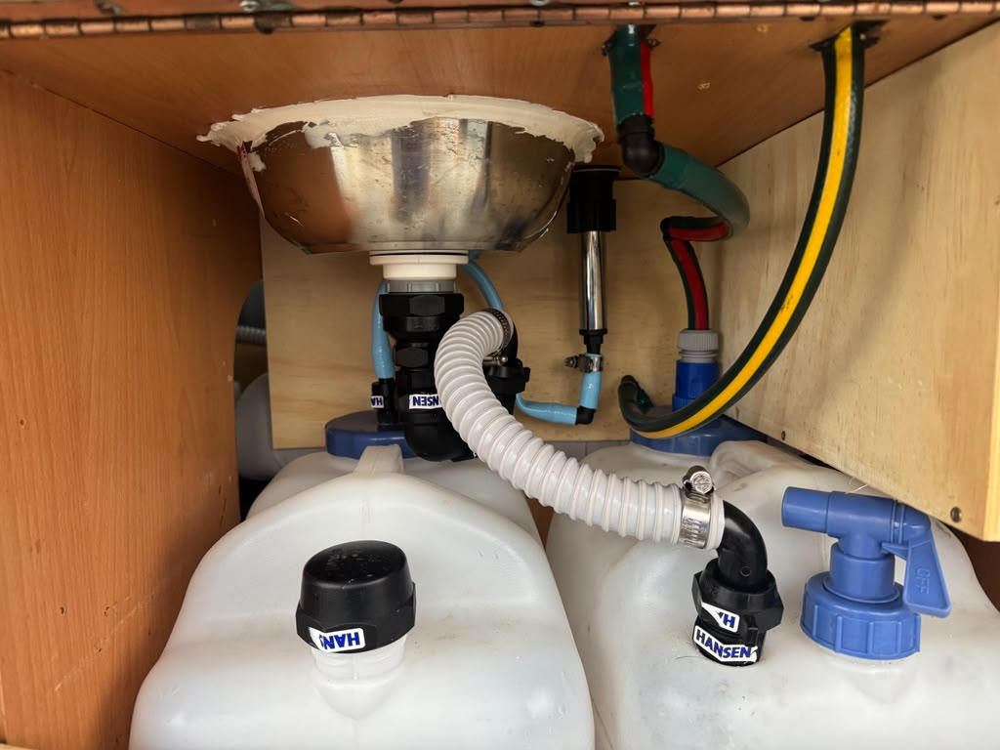
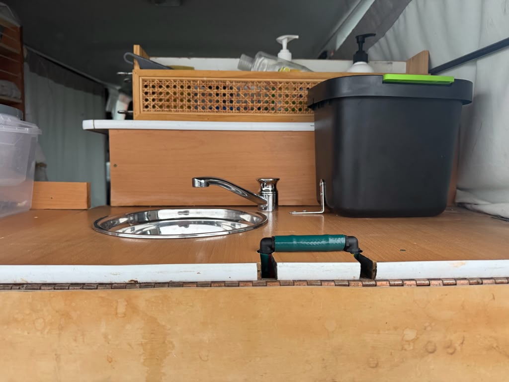
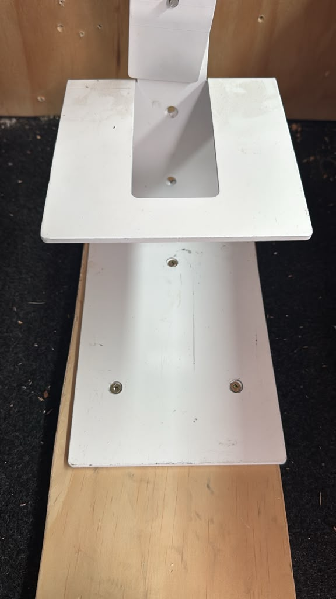

The Campervan Conversion project was a task I undertook to earn the green self-contained certification for my van in New Zealand.
This involved rebuilding the sink plumbing and installing a bracket for a portable toilet.

## Sink Plumbing 

The water is pumped up the light blue food grade hose up to the sink.
Grey water goes down into the gray hose pipe into the wastewater tank on the right
The red/green and yellow/green hoses are for ventilation and the outlet goes outside the vehicle

## Sink

The handpump sink and ventilation hose rising above sink level before descending outside the vechicle.

## Toilet Bracket

